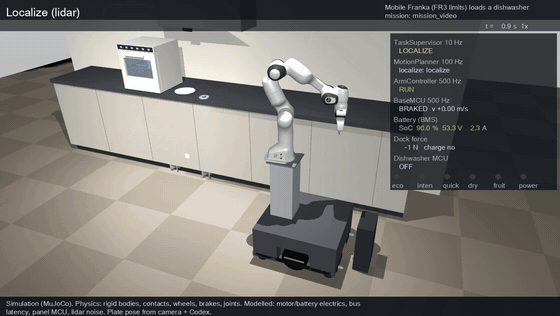
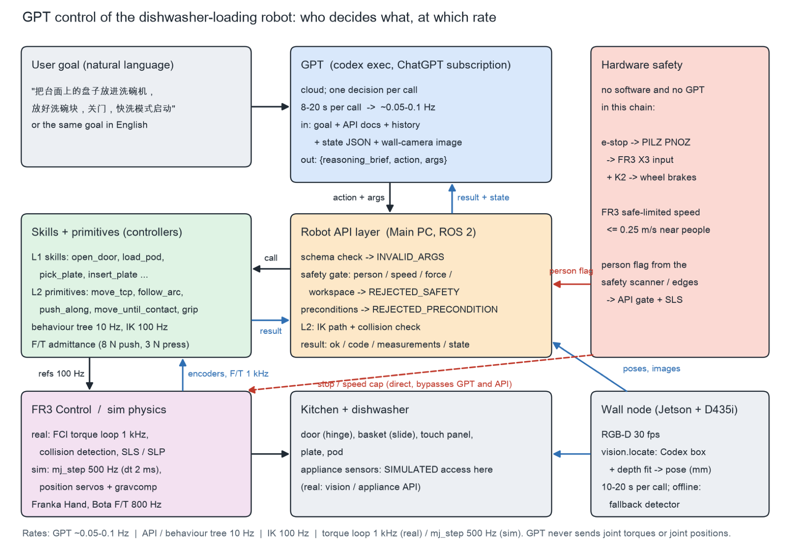
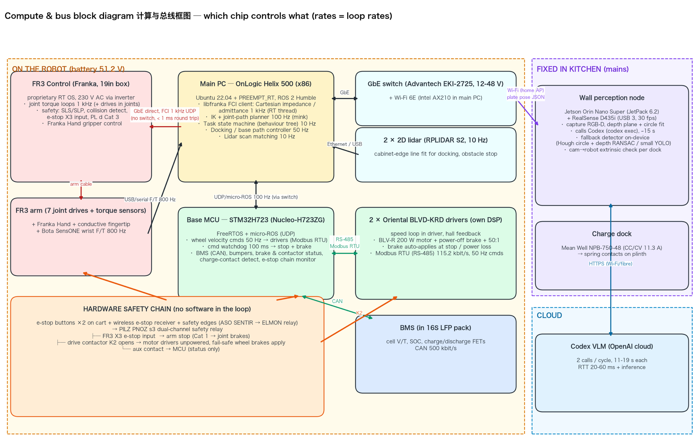
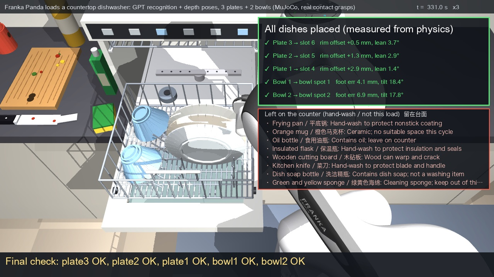
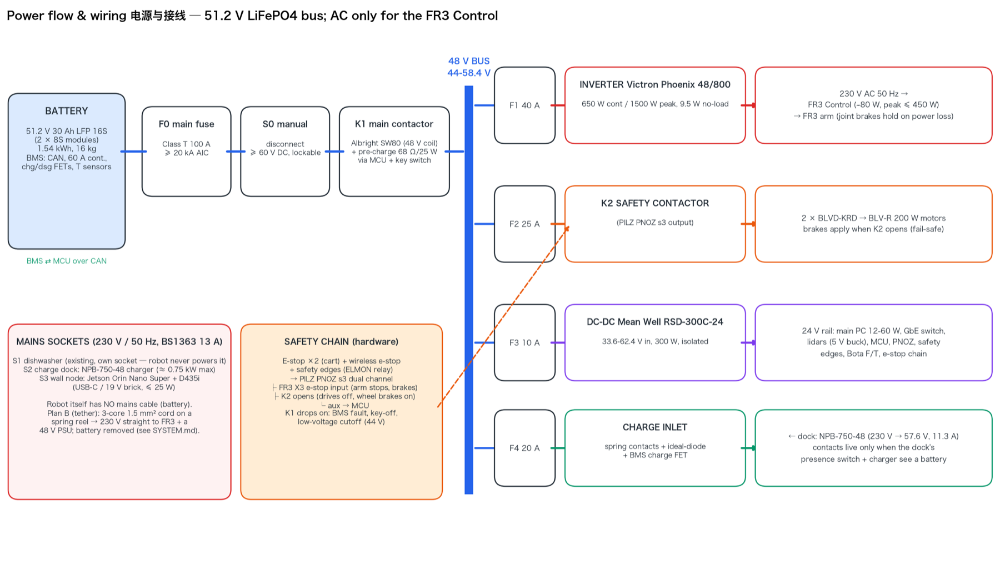

# Sink to Shelf

**From the messy sink to a loaded dishwasher.**



**Common Ground Makeathon 2026, SQ Collective Singapore.** Tracks: Design × Tech, Culture × Tech.

A wheeled robot leaves its charger, docks at the kitchen counter, and a Franka FR3 arm loads a
countertop dishwasher (BREMED E804 class). It opens the door, puts a detergent pod in the door groove,
pulls the basket out, picks a flat plate off the counter, slots it upright between the tines, pushes
the basket in, closes the door, and presses POWER, then QUICK, then POWER. Then it drives back to its
charger. On a cluttered kitchen counter, GPT recognises every item (13/13) and decides what goes into the
dishwasher. The arm then loads 3 plates and 2 bowls into their places from the perceived poses (GPT box + depth): 5/5
with a gripper, and again 5/5 with a suction cup.
GPT (through `codex exec` on a ChatGPT subscription) is the robot's task-level brain. It
chooses and sequences validated skills, reads their results, and recovers from faults. Force control,
trajectories, collision checks and safety stay in the robot's own controllers.

> **Status, honestly:** this is a **physics simulation in MuJoCo** plus a **costed real-hardware design**
> (parts, power, chips, safety chain, BOM). It is **not yet a physical robot**. Water, washing, the door
> latch and real capacitive touch are not simulated; see [Limitations](#limitations).

- **Demo video:** [`docs/media/demo_final.mp4`](docs/media/demo_final.mp4)
- **Demo page (GitHub Pages):** `https://<user>.github.io/<repo>/`, served from [`docs/index.html`](docs/index.html) *(fill in the URL after enabling Pages)*
- **Slides:** [`docs/slides.html`](docs/slides.html) (arrow keys to navigate)

Timeline: the event prompts and proofs of concept date from 10 Oct 2026. The pipelines were built
overnight from 10 to 11 Oct, and the GPT control study and this submission on 11 Oct.

---

## Why

Loading the dishwasher is a small, daily task that needs bending, reaching and fine handling. For older
people, carers and busy families in compact kitchens, it is one more chore that never ends. A countertop
dishwasher already removes the washing. The remaining step is putting things in and pressing start, and
that is the step we automate. The robot works with an unmodified appliance and an unmodified kitchen
counter. It only needs a docking strip on the plinth and a charger.

## Architecture



| Layer | Runs on (real design) | Rate | Owns |
|---|---|---|---|
| GPT (`codex exec`) | cloud | about 1 decision per 10 s | task order, skill parameters, diagnosis and recovery, when to ask a human |
| Robot API | main PC, ROS 2 | per call | schema check, safety gate (person / speed / workspace), preconditions, measured verdicts |
| Skills and planner | main PC (PREEMPT_RT) | IK 100 Hz, behaviour tree 10 Hz | door arc, pod, basket, edge push / pinch / tilt / insert, guarded presses |
| Arm control | Franka FR3 Control | 1 kHz torque loop (sim: `mj_step` 500 Hz) | joint control, collision detection, safe-limited speed |
| Base MCU | STM32H723 | wheel commands 50 Hz, watchdog 100 ms | drives, brakes, BMS, bumpers, e-stop chain monitor |
| Wall node | Jetson Orin Nano Super + RealSense D435i | 10–20 s per Codex call | RGB-D capture, Codex detection, depth fit to a millimetre pose |
| Hardware safety | PILZ PNOZ s3 relay | no software | e-stop to the FR3 X3 input plus drive contactor K2 (fail-safe wheel brakes) |

Sources: `gpt_control/GPT_CONTROL.md` §4, `system_design/SYSTEM.md` §1, `mobile_pipeline/MOBILE_RESULTS.md` (controller architecture).



## Results (all from logged simulation runs)

### 0. The kitchen: recognise, then load plates and bowls



**The climax of the video: recognise, then load, in one run.** Source: [`multi_dish_b/DEMO_NOTES.md`](multi_dish_b/DEMO_NOTES.md), kitchen section.
The counter holds 3 plates, 2 bowls and 8 clutter items. One live GPT call (29.3 s) sees an overhead camera image and
labels every item. Depth back-projection inside GPT's boxes gives each dish's pose, and the arm grasps from those
**perceived** poses (no ground-truth fallback was needed).

| Quantity | Value |
|---|---|
| Items found by GPT | **13/13**; every dishwasher-safe decision sensible (the cast-iron pan was called "nonstick", but the decision, hand-wash, is right) |
| Perceived pose error (plates / bowls) | 0.73–0.93 mm / 0.98–1.19 mm |
| Dishes placed (gripper) | **5/5**: plate lowest-rim offsets +0.5 / +1.3 / +2.9 mm, lean 3.7 / 2.9 / 1.4°; bowl foot-ring 4.1 / 6.9 mm |
| Clutter disturbed | none: at most 0.85 mm of drift, 0.25° of tilt |
| Same counter with a suction cup (`multi_dish_suction/DEMO_NOTES.md`) | **5/5** from perceived poses, 0 seal losses, 0 robot contacts with clutter |
| Not loaded | the mug (dishwasher-safe, "not loaded this cycle" by GPT's own choice) and every non-safe item |

Simplifications: one clean rendered image, recognition once at the start, door already open and basket out, clutter placed outside the arm's sweep.


**Recognition at scale.** Source: [`gpt_sort/GPT_SORT.md`](gpt_sort/GPT_SORT.md). The setup is a cluttered counter with 6–9 random items (plates, bowls, mugs, chopping board, knife, pot, flask) and soil decals. GPT sees two camera images and one sentence from the user. It makes one structured call per scene and decides, for each item: dishwasher-safe or not, category, basket position and load order, and wash program.

| Quantity (24 runs = 12 scenes × English / Chinese goal) | Value |
|---|---|
| Items detected / dishwasher-safe correct / category correct | **164/164** / 164/164 / 164/164 |
| Plans structurally feasible | 24/24 |
| Plate loaded by the robot and seated (< 15°) | 24/24 (23/24 < 10°) |
| Wash program = ground-truth rule | 16/24; 22/24 when applied to GPT's own soil labels |
| Soil level correct / greasy correct (safe items) | 76/104 (73 %) / 90/104 (87 %) |
| GPT cost per scene | 2 calls, median 42 s |

In gpt_sort, the robot itself loads only one plate per scene (slot P4); bowls and mugs go to a human.

**Custom 3D-printed fingers.** Source: [`multi_dish_fingers/DEMO_NOTES.md`](multi_dish_fingers/DEMO_NOTES.md). A rim-hook finger and a 2 mm wedge-blade finger (80 mm, PETG + TPU, printable STLs in `multi_dish_fingers/fingers/`) take 2 nested bowls and 3 stacked plates off their piles: **5/5** placed, 0 unexpected robot contacts, plates leaning 1.0–2.1°. At stock length (53.5 mm) the same tips place 0/3 plates, because the hand body hits the counter. Honest note: the final alignment above the slot is closed-loop on the measured (simulator) dish pose.

### 1. Arm on a docked cart: the full 9-step task
Source: [`full_pipeline/RESULTS.md`](full_pipeline/RESULTS.md), [`full_pipeline/MOUNTING.md`](full_pipeline/MOUNTING.md). Each trial is one continuous MuJoCo run with real camera and Codex perception. The plate pose is randomised by ±10 mm and ±10°.

| Mounting option | Trials | Full success | Clean (no unplanned contact > 20 N) | Cycle time (sim) |
|---|---|---|---|---|
| **M1: docked cart** (chosen) | 10 | **10/10** | 10/10 | 185.3–186.0 s, plus 2 Codex calls (212–220 s total) |
| M2: cart + 0.40 m linear axis | 10 | 10/10 | 10/10 | 189.7–191.4 s |
| M3: counter clamp (plate in a drying rack) | 5 | 0/5 | 0/5 | fails at the door close (3/5) or the rack grasp (2/5) |

Key M1 numbers, min / mean / max over 10 trials (`full_pipeline/RESULTS.md`):

| Quantity | Value |
|---|---|
| Plate centre error at start (Codex + depth) | 0.44 / 0.88 / 1.75 mm |
| Re-perception at the counter edge | 0.74 / 0.95 / 1.65 mm |
| Edge-push overhang (design 45 mm) | 48.4 / 48.7 / 49.1 mm |
| In-hand slip over the 90° tilt | 0.60 / 0.72 / 0.92 mm |
| Door opened / closed | 90.02° / −0.01° |
| Codex call latency | 10.8–19.3 s, mean 15.8 s |
| MuJoCo warnings / unplanned robot contacts | 0 / none |

### 2. Mobile robot: charger → dock → load → start → charger
Source: [`mobile_pipeline/MOBILE_RESULTS.md`](mobile_pipeline/MOBILE_RESULTS.md). The base is a free body on wheel, caster and floor contacts, with lidar localisation, V-block docking and a battery model.

| Quantity | Value |
|---|---|
| Full missions with real Codex vision | **6/6** (5 randomised trials + 1 video run) |
| Mission time (sim) | 265.5–273.4 s |
| Dock error of the arm base vs design | x −1.0…−1.6 mm, y within ±0.8 mm, yaw ≤ 0.09° |
| Energy per mission (battery side) | **9.9–10.2 Wh**, peak current 4.2 A |
| Missions per charge (usable 1229 Wh) | ≈ 120 as simulated; ≈ 95 with the spec's 90 s wake phase |
| Base-pose tolerance without compensation (±2/±5 mm, ±0.2/±0.5°) | 12/12 pass |
| Dock-offset sweep with measured-pose compensation | 10/11 pass (fails at y −4 cm: the reflective strip leaves the lidar's view) |
| E-stop while carrying the plate | arm stops in 0.25 s, TCP travel 2.4 mm, plate slip 0.04 mm, mission then completes |
| Plain (non-conductive) finger on the touch panel | panel stays OFF; supervisor aborts safely and returns to the charger |

### 3. GPT as the brain: hard-coded script vs GPT
Source: [`gpt_control/GPT_CONTROL.md`](gpt_control/GPT_CONTROL.md) §1–2. Seven injected faults, two runs each, plus 5 nominal runs.

| Scenario | Hard-coded script: mission | GPT at skill level (L1): mission / fault handled |
|---|---|---|
| Nominal | 2/2 | 5/5 / 5/5 |
| Door does not latch (springs back to ~68°) | 0/2 | 2/2 / 2/2 |
| Pod not in its dish | 0/2 | 2/2 / 2/2 |
| Plate at a random spot | 0/2 | 2/2 / 2/2 |
| Basket jams at 0.10 m | 0/2 | 2/2 / 2/2 |
| First button press ignored | 0/2 | 1/2 / 2/2 |
| Plate knocked out of the hand | 0/2 | 2/2 / 2/2 |
| Person appears near the robot | 0/2 | 2/2 / 2/2 |
| **All fault runs** | **0/14** | **13/14 / 14/14** |

| Per-mission cost (L1) | Nominal | With a fault |
|---|---|---|
| GPT decision calls | 11 | 12–14 |
| GPT thinking time | ~100–120 s | ~105–135 s |
| Robot motion (sim) | ~185 s | ~190–250 s |
| Decision latency | median 9.5 s, p90 13.6 s | |

What we learned:
- Letting GPT compose raw motion primitives (L2) completed 0 of 3 nominal missions within a 160-turn budget.
- Joint or torque control by GPT (L0) is ruled out by latency: one decision spans about 9,500 torque cycles.
- In 5 of 38 L1 missions, GPT claimed success on a step it could not observe. A real system needs verification sensors or human confirmation for those steps.

### 3b. More GPT studies
Each folder has its own write-up with the full tables. The run counts are small (often one run per cell), as the write-ups say.

| Study | Question | Headline |
|---|---|---|
| [`gpt_mobile/GPT_MOBILE.md`](gpt_mobile/GPT_MOBILE.md) | Can GPT command the whole mobile mission (charger → dock → 9 steps → charger)? | Full-GPT nominal **3/3** (≈ 22 calls, ≈ 153 s of GPT time, 15.2 Wh per mission). "Hybrid" (fixed sequence, GPT only on anomalies) 1/1 with **0 calls and 9.6 Wh**. Recommendation: Hybrid by default, GPT as the exception handler. |
| [`gpt_engineer/GPT_ENGINEER.md`](gpt_engineer/GPT_ENGINEER.md) | Can GPT fix real simulation problems on its own? | 3 problems fixed in the first round with 4–8-line patches. Example: plate lean, baseline 0/5 → 5/5, final lean 1.4–2.4°, then 18/18 on held-out checks. With that knob frozen, 0/5 after 8 rounds. |
| [`gpt_adversary/GPT_ADVERSARY.md`](gpt_adversary/GPT_ADVERSARY.md) | Is GPT a useful adversarial tester? | 23 scenarios per method. GPT found **9** distinct failure modes, including the only **4** severe ones (false success claims, knocked-off objects). Uniform random found 3; sparse random found 9 different ones, including 3 GPT missed. |
| [`gpt_sort/GPT_SORT.md`](gpt_sort/GPT_SORT.md) | Can GPT sort a cluttered counter for the dishwasher? | See section 0: 164/164 items classified, 24/24 feasible plans. Weak spot: soil level (73 %), so the wash program matches the rule 16/24. GPT never chose a weaker program than needed. |

### 4. Real-hardware design
Source: [`system_design/SYSTEM.md`](system_design/SYSTEM.md), [`system_design/bom_table.md`](system_design/bom_table.md), `system_design/spec.json`.

| Subsystem | Choice |
|---|---|
| Arm | Franka Research 3 + Franka Hand + Bota SensONE wrist F/T (FR3 kinematics match the simulated Panda; FR3 joint limits re-checked in the mobile sim) |
| Base | differential drive, 2 × Oriental BLV-R 200 W with power-off brakes, 4 casters, 0.65 × 0.60 m, 133.2 kg total |
| Battery | 51.2 V 30 Ah LiFePO4 (1.54 kWh), Mean Well NPB-750-48 charger (11.3 A) |
| Arm power | Victron Phoenix 48/800 inverter (the FR3 controller needs 100–240 VAC) |
| Compute | OnLogic Helix 500 main PC (PREEMPT_RT, ROS 2), STM32H723 base MCU, Jetson Orin Nano Super wall node |
| Docking | 2 × RPLIDAR S2 line-fit on the cabinet fronts, then reverse into plinth V-blocks at 100 N and brake |
| Touch panel | conductive silicone fingertip, wired to chassis ground (needs a real test on the E804 panel) |
| Safety | PILZ PNOZ s3 hardware e-stop chain, safety edges on 4 sides, ≤ 0.25 m/s TCP near people |
| **Cost** | **US$ 53,279 incl. 10 % contingency (≈ S$ 69,263)**; arm + hand + F/T ≈ US$ 36.4k |



## How to run

Tested on macOS (Apple silicon), Python 3.12. Everything runs from the repo root; scripts find it on their own,
or set `GYJ_WORK=/path/to/repo` to override.

```bash
python3.12 -m venv .venv
.venv/bin/pip install mujoco==3.15.0 mink==1.3.0 "imageio[ffmpeg]" pillow scipy matplotlib
# MuJoCo Menagerie, Panda model only (sparse checkout into the repo root)
git clone --depth 1 --filter=blob:none --sparse https://github.com/google-deepmind/mujoco_menagerie.git
git -C mujoco_menagerie sparse-checkout set franka_emika_panda
```

**GPT / Codex.** Perception (object detection) and all GPT decisions go through the `codex` CLI
(`codex exec --sandbox read-only --output-schema ...`), logged in with a ChatGPT account. No API key is
used or stored in this repository. Install the Codex CLI and run `codex login` first. `--debug-truth-perception`
replaces Codex with the true plate pose plus noise. It is for development only and is labelled DEBUG in
every output; no reported number uses it.

Each run is one process; the shell runners kill it above 3 GB RSS:

```bash
mkdir -p gpt_control/logs mobile_pipeline/out multi_dish_b/logs multi_dish_suction/logs   # runner log folders
.venv/bin/python full_pipeline/run.py --option M1                        # one M1 run with video (~5 min wall)
.venv/bin/python full_pipeline/run.py --option M1 --trials 10 --no-video  # the 10-trial table
mobile_pipeline/guard.sh mission_video run_mobile.py --video              # one mobile mission
gpt_control/runw.sh logs/x.log gpt_agent.py --level L1 --scen door_latch --seed 3 --goal zh
multi_dish_b/runw.sh logs/k.log multi.py --tag _k --frames frames_kitchen  # kitchen: GPT recognition -> 3 plates + 2 bowls
multi_dish_suction/runw.sh logs/x.log kitchen_demo.py                      # the same counter with a suction cup
```

Outputs go to each folder's `out/` (ignored by git).

## Repo layout

```
dishwasher_model/            BREMED E804-class countertop dishwasher model (door, basket, tines, panel) + tests
full_pipeline/               9-step task on a docked cart: scene, controller, Codex perception, mounting study
mobile_pipeline/             free-body wheeled base, lidar docking, battery, message bus, task supervisor, skill API
system_design/               real-hardware design: SYSTEM.md, spec.json, calculations, BOM, diagrams
gpt_control/                 GPT (codex exec) control: robot API, safety gate, faults, L1/L2 study, API.md
gpt_mobile/, gpt_sort/, gpt_adversary/, gpt_engineer/   follow-up GPT studies (code, write-up, results.json)
multi_dish_b/                kitchen counter: GPT recognition + depth -> 3 plates + 2 bowls with the gripper
multi_dish_suction/          the same with a suction cup (Franka Cobot Pump)
multi_dish_fingers/          custom 3D-printed wedge / rim-hook fingers (STLs + demo)
recognition_card/            standalone GPT recognition of a messy counter (scoring vs ground truth)
docs/                        GitHub Pages: index.html, slides.html, media/demo_final.mp4, assets/ (images)
```

Each folder holds only the entry scripts, the modules they import and the write-up with its result files.
Large raw outputs (full-length run videos, per-run dumps, logs) are not included.

## Limitations

- **Simulation only.** Rigid primitives everywhere: the plate is 36 rim boxes, the tines are rigid capsules. No water, washing, latch or door gasket.
- **Touch panel.** Buttons are touch sensors plus a "conductive + force + dwell" rule. Real capacitance is not modelled, and the E804 panel logic is our assumption.
- **Perception.** Clean synthetic renders with Gaussian depth noise. Codex gives the 2-D detection; the millimetre pose comes from depth geometry and a known plate model. The pod pose is not perceived in the nominal task.
- **Appliance state.** Door angle, basket travel and panel display are simulated sensor access in the GPT study.
- **Scope.** The charger-to-charger mission handles one plate and one pod. The 5-dish kitchen runs start docked, with the door open and the basket out, and see one clean rendered image. The run counts (10 trials, 6 missions, 2 runs per fault, 4 multi-dish runs) show feasibility, not reliability.
- **Arm model.** The simulated arm is the Menagerie Panda with FR3 joint limits applied in the mobile pipeline; FR3 masses and inertias are not used.
- **GPT.** About 10 s per decision, so the arm waits about 32 % of an L1 mission. 5 of 38 L1 success claims were false, all on steps GPT could not observe. GPT needs the network; the planned offline fallback is a local behaviour tree with GPT as an exception handler.
- **Cost.** BOM prices are reseller listings or estimates (tagged V / R / E in `bom_table.md`), not quotes.

## Credits and licences

- [MuJoCo](https://github.com/google-deepmind/mujoco) 3.15.0 (Apache-2.0), Google DeepMind.
- Franka Emika Panda model from [MuJoCo Menagerie](https://github.com/google-deepmind/mujoco_menagerie) (`franka_emika_panda/`, **Apache-2.0**, per its `LICENSE` and README). It is not vendored here; see How to run.
- [mink](https://github.com/kevinzakka/mink) 1.3.0 differential-IK library.
- GPT via the OpenAI Codex CLI (`codex exec`) on a ChatGPT subscription.
- Hardware named in the design (Franka, Bota, Oriental Motor, Victron, Mean Well, OnLogic, STMicroelectronics, NVIDIA, Intel RealSense, Slamtec, PILZ, Leoch and others) is referenced by product name only; the design is not endorsed by these companies.
- Author: Yuanjing Guo.

Licence for this repository's own code: _[to be chosen by the team before making the repo public]_.
